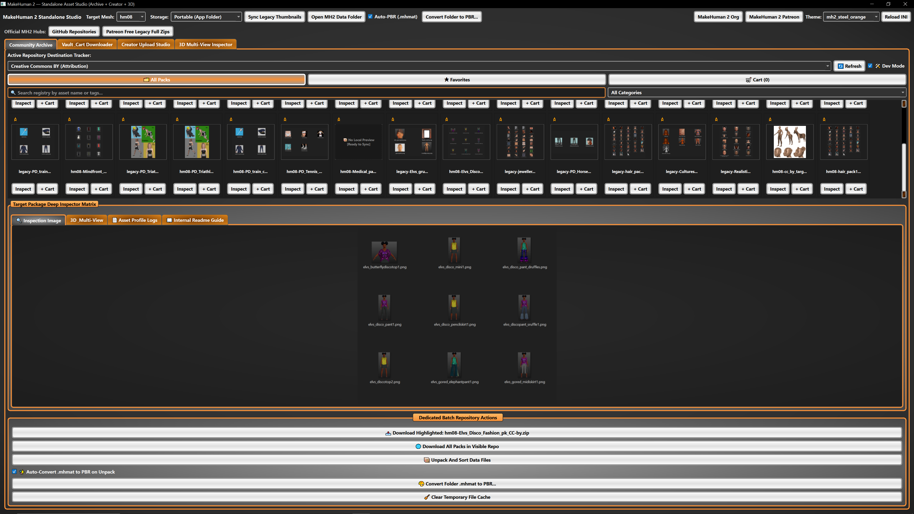
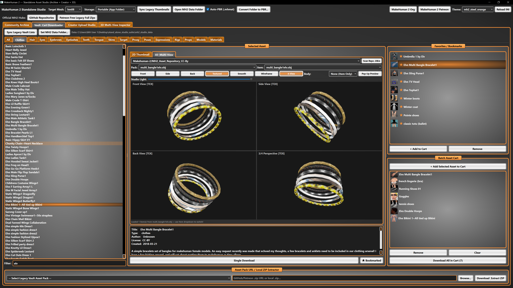
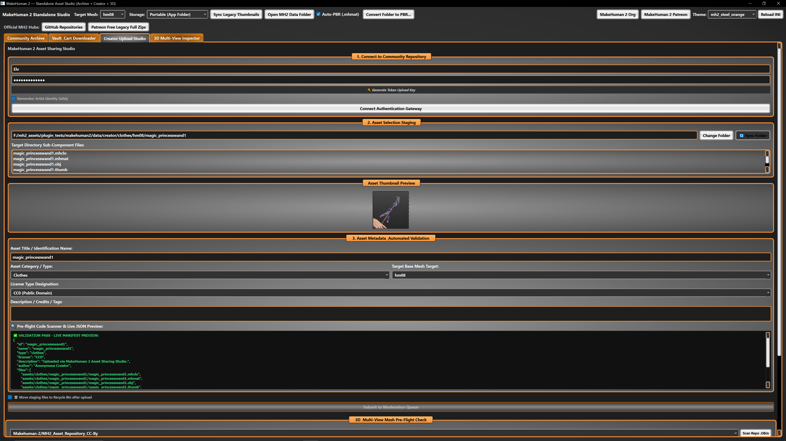
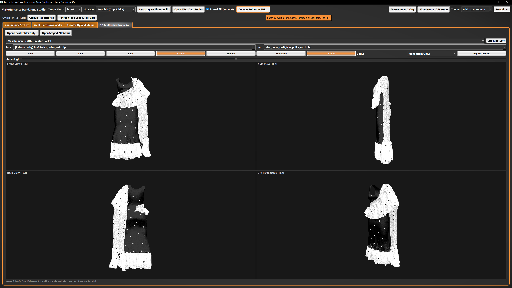

# MH2_Creation_Archivist
A stand alone version of the Creator plus Archivist including legacy browsing, 3d viewer and more.

There is also a PBR MHMAT converter built in.  
  
# Demo  
  
  
  
  
  

There is a simple exe version available in the releases, no install needed just put on desktop in a folder  
and give it a go!  
